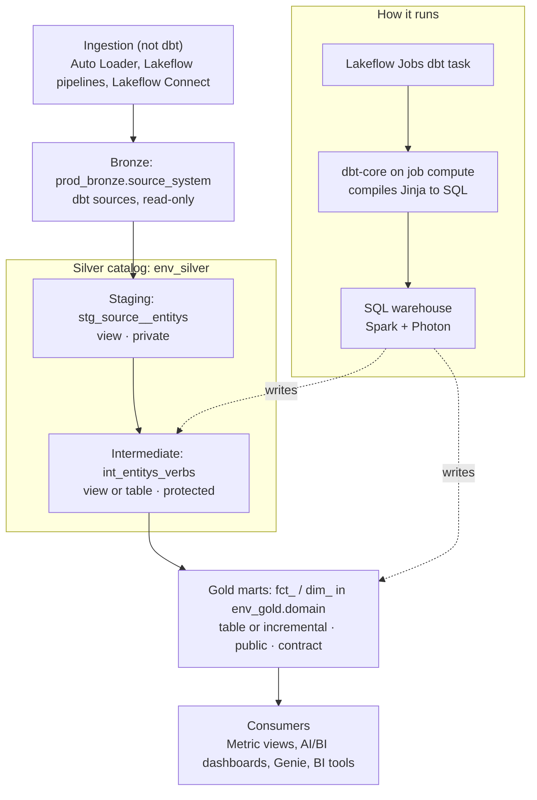

# Databricks + dbt Engineering Standards

Nov 2, 2026 · Sanmari Vivier

## 1. Purpose and scope

All transformation from bronze to gold MUST be written as dbt models. They are compiled by dbt-core on Databricks and executed by Spark/Photon on a Databricks SQL warehouse. This standard covers everything inside the Databricks platform: Unity Catalog, Lakeflow ingestion, SQL warehouses, Lakeflow Jobs (dbt task) and Databricks Git folders. Tools outside Databricks (dbt Cloud, external orchestrators, other warehouses) are out of scope.

**Audience:** data engineers and analytics engineers building or reviewing dbt projects on Databricks.

**Keywords:**

| Keyword | Meaning |
| --- | --- |
| MUST / MUST NOT | Mandatory. CI blocks the pull request when it is violated. |
| SHOULD / SHOULD NOT | Default. A departure needs a one-line reason in the pull request. |
| MAY | Optional. Use when it helps. |

The rules build on the dbt Labs best-practice guides (see Sources). Where this standard is stricter than dbt Labs, it says so. The main case: gold models read only from intermediate models, never from staging.

## 2. Reference architecture

Data moves one layer at a time: ingestion → bronze → staging → intermediate → marts → consumers. dbt owns every step from staging to marts. It compiles and orders the SQL, and the SQL warehouse runs it on Spark with Photon.



The left column is where data lives; the right column is what executes it. The only link between them is the SQL that dbt sends to the warehouse.

## 3. Unity Catalog layout

Each environment gets its own silver and gold catalogs, named `<env>_<layer>`. Every environment reads the same read-only bronze catalog. The folder a model sits in decides its catalog and schema. Nobody sets them by hand in a model.

### 3.1 Catalogs and schemas

| Layer | dbt folder | Catalog (dev / test / prod) | Schema | Created by |
| --- | --- | --- | --- | --- |
| Bronze | `sources` (YAML only) | `prod_bronze` (shared, read-only) | `<source_system>`, e.g. `salesforce` | Lakeflow ingestion |
| Silver: staging | `models/staging/` | `dev_silver` / `test_silver` / `prod_silver` | `staging` | dbt |
| Silver: intermediate | `models/intermediate/` | `dev_silver` / `test_silver` / `prod_silver` | `intermediate` | dbt |
| Gold: marts | `models/marts/<domain>/` | `dev_gold` / `test_gold` / `prod_gold` | `<domain>`, e.g. `finance` | dbt |

- Platform admins MUST create catalogs. dbt MUST create every schema. Nobody creates schemas by hand.
- Staging and intermediate MUST be in separate schemas. Sharing one schema removes the boundary between them.
- In dev, each developer's schemas MUST carry their target schema as a prefix (`dbt_jsmith_staging`) so developers never overwrite each other.
- If governance requires per-environment bronze, switch the source catalog on `target.name` in the source YAML. Never fork the model SQL.

### 3.2 Routing macros

The project MUST hold these two macros in `macros/` and MUST NOT override them per model.

```sql
{# macros/generate_database_name.sql #}

    
        {{ target.database }}
    
        {{ target.name }}_{{ custom_database_name | trim }}
    


{# macros/generate_schema_name.sql #}

    
        {{ target.schema }}
    
        {{ custom_schema_name | trim }}
    
        {{ target.schema }}_{{ custom_schema_name | trim }}
    

```

With `+database: silver` and `+schema: staging`, a model builds into `prod_silver.staging` in prod and `dev_silver.dbt_jsmith_staging` in dev.

### 3.3 Identities and grants

| Principal | `prod_bronze` | `dev_*` | `test_*` | `prod_*` |
| --- | --- | --- | --- | --- |
| Developers (group) | USE, SELECT | USE, CREATE SCHEMA, SELECT, MODIFY | none | SELECT on gold only |
| CI service principal | USE, SELECT | none | USE, CREATE SCHEMA, SELECT, MODIFY | none |
| Prod service principal | USE, SELECT | none | none | USE, CREATE SCHEMA, SELECT, MODIFY |
| BI and consumer groups | none | none | none | SELECT on `prod_gold` only |

- Production jobs MUST run as the prod service principal, never as a person.
- Consumer grants MUST be declared with the dbt `grants` config in YAML, not hand-written `GRANT` statements:

```yaml
models:
  my_project:
    marts:
      +grants:
        select: ['bi_analysts', 'finance_readers']
```

- Consumers MUST NOT get access to `*_silver` catalogs. Silver is an engineering workspace, not a product.

## 4. Bronze and sources

Bronze is loaded by Databricks ingestion, never by dbt. dbt only declares bronze tables as sources and reads them from staging.

### 4.1 Ingestion into bronze

- Bronze MUST be loaded with Databricks-native ingestion: Auto Loader, Lakeflow Declarative Pipelines (streaming tables) or Lakeflow Connect.
- Bronze tables MUST keep the source's data as landed: no renames, no business filters, no joins.
- Each bronze table MUST carry an ingestion timestamp column (e.g. `_ingested_at`) and SHOULD carry `_source_file` for file loads. Staging uses these for freshness and incremental filters.
- The ingestion task MUST run as an upstream task in the same Lakeflow job as the dbt task, or on its own schedule with freshness checks guarding dbt (section 12).

### 4.2 Declaring sources

- Every bronze table that dbt reads MUST be declared in a `_<source>__sources.yml` file inside `models/staging/<source>/`.
- Each source MUST have a `description`, a `loaded_at_field` and a freshness rule.
- An unused source declaration MUST be removed.

```yaml
# models/staging/salesforce/_salesforce__sources.yml
sources:
  - name: salesforce
    database: prod_bronze
    schema: salesforce
    description: Salesforce CRM objects landed by Lakeflow Connect.
    config:
      loaded_at_field: _ingested_at
      freshness:
        warn_after: {count: 12, period: hour}
        error_after: {count: 24, period: hour}
    tables:
      - name: account
        description: One row per Salesforce account.
      - name: opportunity
        description: One row per sales opportunity.
```

### 4.3 The source() rule

- `source()` MUST appear only in models under `models/staging/`.
- Hard-coded table names (`prod_bronze.salesforce.account`) MUST NOT appear in any model. Use `source()` or `ref()` so lineage and environment routing keep working.

## 5. Silver: staging layer

Each staging model is the single clean entry point for exactly one bronze table. It renames, casts and lightly cleans data. It never joins or aggregates.

### 5.1 Structure and naming

- Each source system MUST have its own folder: `models/staging/<source>/`. Do not group by loader or by business area.
- Models MUST be named `stg_<source>__<entity>s` (double underscore, plural entity), e.g. `stg_salesforce__accounts`.
- Each bronze table MUST have exactly one staging model (1:1).
- Model properties MUST be declared in `_<source>__models.yml` in the same folder.

### 5.2 Allowed and forbidden transformations

| Allowed | Forbidden |
| --- | --- |
| Renaming to business terms and naming standards (section 9) | Joins to other sources or models |
| Casting to the correct type (`DATE`, `TIMESTAMP`, `DECIMAL(p,s)`) | Aggregations or `GROUP BY` |
| Simple maths (cents to currency, unit conversion) | Business rules or KPI logic |
| Categorising with `CASE` into buckets or `is_`/`has_` booleans | Filtering out business-valid rows |
| Trimming, null handling, timezone conversion to UTC | Reading from `ref()` (staging reads only `source()`) |
| Deduplicating exact duplicates from ingestion | Window functions that change the grain |

When a clean concept needs a union or a join (e.g. one table per region, or a soft-delete table), build `base_<source>__<entity>` models in `models/staging/<source>/base/`. The staging model then combines them. This is the only exception to the no-join rule.

### 5.3 Template

```sql
-- models/staging/salesforce/stg_salesforce__accounts.sql
with

source as (

    select * from {{ source('salesforce', 'account') }}

),

renamed as (

    select
        -- ids
        cast(id as string) as account_id,
        cast(owner_id as string) as owner_user_id,

        -- strings
        trim(name) as account_name,
        upper(billing_country) as billing_country_code,

        -- numerics
        cast(annual_revenue as decimal(18, 2)) as annual_revenue,

        -- booleans
        coalesce(is_deleted, false) as is_deleted,

        -- timestamps
        cast(created_date as timestamp) as created_at,
        _ingested_at

    from source

)

select * from renamed
```

### 5.4 Materialisation and access

- Staging models MUST be materialised as `view` by default. Use `incremental` only when a large bronze table makes the view too slow downstream.
- Staging models MUST be `access: private` in a silver group (section 7.4), so only silver models can `ref()` them.
- Staging models MUST have a primary key with `unique` and `not_null` tests.

## 6. Silver: intermediate layer

All business logic, joins, re-graining and heavy aggregation MUST happen in intermediate models. They read from staging and other intermediate models, and they are never shown to consumers.

### 6.1 Structure and naming

- Intermediate models MUST be grouped by business domain, not source: `models/intermediate/<domain>/`, e.g. `finance/`, `sales/`.
- Models MUST be named `int_<entity>s_<verb>s`, where the verb says what the model does: `int_order_items_joined`, `int_payments_pivoted_to_orders`, `int_opportunities_aggregated_to_account`.
- Keep a double underscore only when the model must stay source-specific before a union, e.g. `int_shopify__orders_summed`.
- Properties MUST be declared in `_int_<domain>__models.yml`.

### 6.2 What belongs here

| Purpose | Example |
| --- | --- |
| Structural simplification: combine 4 to 6 staging models into one concept | `int_customers_joined` brings together CRM, billing and support customers |
| Re-graining: fan rows out or collapse them to the grain a mart needs | `int_orders_fanned_out_by_quantity` produces one row per unit |
| Isolating complex logic so it can be tested and reused | `int_revenue_recognised` holds the revenue recognition rules |
| Aggregations and window logic | `int_opportunities_aggregated_to_account` |
| Business keys and surrogate keys | `dbt_utils.generate_surrogate_key()` for multi-column keys |

### 6.3 Rules

- Intermediate models MUST read only through `ref()` to staging or other intermediate models. They MUST NOT call `source()` or `ref()` a mart.
- An intermediate model SHOULD feed few children. Many inputs are fine, but one model feeding many marts is a sign that the logic belongs in a mart or needs splitting.
- Models MUST be `access: protected` so marts in the project can read them.

### 6.4 Materialisation

| Situation | Materialisation |
| --- | --- |
| Default, light logic | `view` |
| Heavy joins or aggregations, or read by two or more marts | `table` |
| Large fact-grain data where a full rebuild takes too long | `incremental` (section 8) |
| Rarely; tiny helper logic used once | `ephemeral` |

Ephemeral models SHOULD NOT be used for heavy logic. Their SQL is inlined into every child, so they cannot be queried or debugged on their own.

## 7. Gold: marts layer

Marts are the only models consumers see. Each mart is one entity at one fixed grain, built only from intermediate models (or other marts), with an enforced contract.

### 7.1 Structure and naming

- Marts MUST be grouped by business domain: `models/marts/<domain>/`. Each domain is its own gold schema.
- Facts MUST be named `fct_<business_process>s` (`fct_orders`, `fct_invoice_lines`). Dimensions MUST be named `dim_<entity>s` (`dim_customers`, `dim_products`).
- Names MUST NOT include a team (`finance_orders`) or a time roll-up (`orders_per_day`). Roll-ups are metrics (section 11).
- Properties MUST be declared in `_<domain>__models.yml`.

> **Departure from dbt Labs:** dbt Labs names marts in plain English (`orders`, `customers`) and lets marts read staging. This standard uses `fct_`/`dim_` prefixes for star-schema clarity in Unity Catalog. It also requires every mart to read only from intermediate models.

### 7.2 Design rules

- Each mart MUST have one stated grain, written in its YAML `description`, and a tested primary key.
- Marts SHOULD be wide and denormalised: bring in descriptive columns rather than forcing consumers to join.
- A mart SHOULD NOT combine more than 4 to 5 concepts. Beyond that, add an intermediate model.
- A mart MAY `ref()` another mart (e.g. `fct_orders` reads `dim_customers` for a key). It MUST NOT create a cycle.
- One concept MUST have one mart. Do not build the same entity twice for different teams.

### 7.3 Contracts, constraints and materialisation

- Every mart MUST be `access: public` with `contract: {enforced: true}`. Every column MUST be listed with its `data_type`.
- Primary keys MUST be declared as `not_null` and `primary_key` constraints. Unity Catalog records primary keys as informational, and Databricks enforces `not_null`.
- Marts MUST be materialised as `table` or `incremental`, never `view`.
- A breaking change to a public mart MUST ship as a new model version (`_v2`) with a `deprecation_date` on the old version.

```yaml
# models/marts/finance/_finance__models.yml
models:
  - name: fct_orders
    description: One row per order. Grain = order_id.
    config:
      materialized: incremental
      contract: {enforced: true}
      access: public
      group: finance
    columns:
      - name: order_id
        data_type: string
        constraints:
          - type: not_null
          - type: primary_key
        data_tests: [unique]
      - name: customer_id
        data_type: string
      - name: order_total
        data_type: decimal(18,2)
      - name: ordered_at
        data_type: timestamp
```

### 7.4 Enforcing "gold never reads staging"

This rule is enforced in two ways: dbt rejects the reference when it parses the project, and a CI check backs that up.

1. **Groups and access.** Put all staging and intermediate models in one `silver` group. Staging is `private` and intermediate is `protected`. Marts sit in domain groups (`finance`, `sales`). When a mart calls `ref('stg_...')`, dbt fails with an access error because a private model can only be read from its own group.

```yaml
# models/_groups.yml
groups:
  - name: silver
    owner: {name: Data Engineering, email: data-engineering@company.com}
  - name: finance
    owner: {name: Finance Analytics, email: finance-analytics@company.com}
```

```yaml
# dbt_project.yml (extract)
models:
  my_project:
    staging:
      +group: silver
      +access: private
    intermediate:
      +group: silver
      +access: protected
```

2. **CI lineage check.** CI runs `dbt-project-evaluator` and this script over `target/manifest.json`. It fails the pull request if a model breaks the layer rules.

```python
# ci/check_layers.py
import json, sys

nodes = json.load(open("target/manifest.json"))["nodes"]
errors = []
for node in nodes.values():
    if node["resource_type"] != "model":
        continue
    name = node["name"]
    parents = [p.split(".")[-1] for p in node["depends_on"]["nodes"]]
    has_source = any(p.startswith("source.") for p in node["depends_on"]["nodes"])
    if name.startswith(("fct_", "dim_")) and any(p.startswith("stg_") for p in parents):
        errors.append(f"{name}: gold model reads staging")
    if not name.startswith(("stg_", "base_")) and has_source:
        errors.append(f"{name}: source() outside staging")
    if name.startswith("int_") and any(p.startswith(("fct_", "dim_")) for p in parents):
        errors.append(f"{name}: intermediate reads gold")
print("\n".join(errors) or "Layer rules OK")
sys.exit(1 if errors else 0)
```

## 8. Materialisations and Databricks performance

Start with the simplest materialisation and move up only when a measured build or query time requires it. Every model MUST be idempotent: running it twice on the same input gives the same table.

### 8.1 Choosing a materialisation

| Materialisation | Databricks statement | Use when |
| --- | --- | --- |
| `view` | `CREATE OR REPLACE VIEW` | Staging; light intermediate logic |
| `table` | `CREATE OR REPLACE TABLE ... USING DELTA` | Heavy intermediate models; most marts |
| `incremental` | `MERGE INTO`, `INSERT INTO ... REPLACE WHERE` or `INSERT OVERWRITE` | Large fact tables where a full rebuild is too slow |
| `materialized_view` | `CREATE MATERIALIZED VIEW` (refreshed by a Lakeflow pipeline) | Aggregates that Databricks should refresh incrementally on serverless compute |
| `streaming_table` | `CREATE STREAMING TABLE` | Near-real-time staging over append-only bronze |
| `ephemeral` | Inlined as a CTE | Tiny helpers only (section 6.4) |

### 8.2 Incremental models

- Every incremental model MUST set `unique_key` (for `merge`) and `on_schema_change: append_new_columns` or `sync_all_columns`. Never use `ignore`.
- Strategy MUST follow the data: `merge` for updates by key, `replace_where` or `insert_overwrite` for whole date partitions, `append` only for immutable event data, `microbatch` for large time-series with an `event_time` column.
- The incremental filter MUST use a lookback window so late data is not lost, and MUST NOT depend on the time the job runs:

```sql
{{ config(
    materialized='incremental',
    incremental_strategy='merge',
    unique_key='order_id',
    on_schema_change='append_new_columns',
    liquid_clustered_by=['ordered_date']
) }}

select ...
from {{ ref('int_orders_joined') }}

where _ingested_at > (select max(_ingested_at) - interval 3 days from {{ this }})

```

- A full refresh (`--full-refresh`) MUST rebuild the same result as the incremental history. If it cannot, set `full_refresh: false` and document why.

### 8.3 Idempotence

- Models MUST NOT use `current_timestamp()`, `current_date()` or `rand()` in filters or keys. Pass dates as `vars` from the job instead.
- Surrogate keys MUST be deterministic hashes (`dbt_utils.generate_surrogate_key`), never `monotonically_increasing_id()` or identity columns that change on rebuild.
- Deduplication MUST order by a deterministic column so ties always break the same way.

### 8.4 Delta and warehouse settings

- Large tables (more than about 1 GB) SHOULD use liquid clustering (`liquid_clustered_by`) on their most-filtered columns instead of `partition_by` or `ZORDER`.
- Tables MUST use Delta. Predictive optimisation SHOULD be enabled on the gold and silver catalogs so `OPTIMIZE` and `VACUUM` run automatically.
- dbt jobs MUST run on a serverless or Pro SQL warehouse with Photon. All-purpose clusters are for Python models only.
- Python models (`.py`) MAY be used only when SQL cannot express the logic, e.g. ML scoring. They run on a job cluster through `submission_method: job_cluster` or `serverless_cluster`.

## 9. Naming and style

Every name is `snake_case`, uses business terms rather than source terms, and avoids abbreviations. SQLFluff, Prettier and ruff check the style rules in CI, so reviewers spend no time on formatting.

### 9.1 Model names

| Layer | Pattern | Example |
| --- | --- | --- |
| Base | `base_<source>__<entity>s` | `base_shopify__orders_eu` |
| Staging | `stg_<source>__<entity>s` | `stg_salesforce__accounts` |
| Intermediate | `int_<entity>s_<verb>s` | `int_payments_pivoted_to_orders` |
| Fact | `fct_<business_process>s` | `fct_orders` |
| Dimension | `dim_<entity>s` | `dim_customers` |
| Version | `<model>_v<n>` | `fct_orders_v2` |

- Model file names MUST be unique across the project and match the table name.
- Names MUST NOT contain dots or abbreviations (`customer`, not `cust`).

### 9.2 Column names

| Kind | Rule | Example |
| --- | --- | --- |
| Primary key | `<entity>_id`, string type; never a bare `id` | `account_id` |
| Foreign key | Same name as the key it points to | `customer_id` everywhere, never `user_id` in one model |
| Surrogate key | `<entity>_key`, deterministic hash | `customer_key` |
| Boolean | `is_` or `has_` prefix | `is_active`, `has_discount` |
| Timestamp | `<past_tense_event>_at`, stored in UTC | `created_at`, `shipped_at` |
| Non-UTC timestamp | Add the zone as a suffix | `created_at_sast` |
| Date | `<past_tense_event>_date` | `ordered_date` |
| Money | `DECIMAL(18,2)` in currency units; suffix any other unit | `order_total`, `price_in_cents` |
| Metadata | Leading underscore | `_ingested_at`, `_source_file` |

- Columns MUST NOT use SQL reserved words (`date`, `order`, `group`).
- Columns SHOULD be ordered by type: ids, strings, numerics, booleans, dates, timestamps.

### 9.3 SQL style

- Lowercase keywords, functions and fields; 4-space indents; trailing commas; lines of 80 characters or fewer.
- All `ref()` and `source()` calls MUST be in import CTEs at the top, each named after its model, selecting only needed columns.
- Each functional CTE does one job and has a descriptive name (`orders_joined_to_customers`). The model ends with `select * from <final_cte>`.
- Use explicit `as` for aliases. Write `inner join` or `left join`, never `join` or `right join`. Use no initialism aliases (`customers`, not `c`).
- When joining, prefix every column with its CTE name.
- Use `union all` unless you need deduplication. Group by position (`group by 1, 2`) or `group by all`.
- Aggregate before joining where possible.
- Use `{# Jinja comments #}` for notes that should not be in compiled SQL.

### 9.4 Jinja, YAML and Python

- **Jinja:** spaces inside delimiters (`{{ this }}`), 4-space indents inside blocks, newlines between logical blocks. Do not spend effort on whitespace control.
- **YAML:** 2-space indents, indented list items, explicit lists even for one item (`select: ['bi_analysts']`), lines of 80 characters or fewer, validated against the dbt JSON schema.
- **Python models:** formatted with black and linted with ruff. The entry point is `def model(dbt, session):`, with `session` being the Spark session.

### 9.5 Linting configuration

```ini
# .sqlfluff
[sqlfluff]
dialect = databricks
templater = dbt
max_line_length = 80

[sqlfluff:indentation]
tab_space_size = 4

[sqlfluff:rules:capitalisation.keywords]
capitalisation_policy = lower

[sqlfluff:rules:layout.long_lines]
ignore_comment_lines = true
```

`.sqlfluffignore` MUST exclude `target/`, `dbt_packages/` and `macros/`.

## 10. Testing and data quality

Every model ships with tests that run in the same `dbt build` that creates it. A failing `error` test stops the models downstream from building, so bad data never reaches gold.

### 10.1 Minimum tests by layer

| Layer | MUST have | SHOULD have |
| --- | --- | --- |
| Sources | Freshness (`warn_after`, `error_after`) | `not_null` on the ingestion timestamp |
| Staging | `unique` + `not_null` on the primary key | `accepted_values` on status and code columns |
| Intermediate | `unique` + `not_null` on the grain key after any re-grain | Unit tests on complex logic |
| Marts | Enforced contract, primary key tests, `relationships` from every fact key to its dimension | Row-count or reconciliation tests against intermediate |

### 10.2 Unit tests

Complex SQL MUST have dbt unit tests: `CASE` trees, window functions, date maths, revenue rules and incremental logic. A unit test checks the logic on fixed inputs, without touching real data.

```yaml
unit_tests:
  - name: test_int_orders_joined_flags_refunds
    model: int_orders_joined
    given:
      - input: ref('stg_shop__orders')
        rows:
          - {order_id: 'o1', order_total: 100.00}
      - input: ref('stg_shop__refunds')
        rows:
          - {order_id: 'o1', refund_total: 100.00}
    expect:
      rows:
        - {order_id: 'o1', is_refunded: true}
```

### 10.3 Custom generic tests

- A check needed on two or more models MUST become a custom generic test in `tests/generic/`, not copied SQL.
- A generic test returns the failing rows. Zero rows means pass.
- Each custom test MUST have a description in `tests/generic/_generic_tests.yml` and SHOULD take a `severity` argument.

```sql
-- tests/generic/test_is_positive.sql


select {{ column_name }}
from {{ model }}
where {{ column_name }} < 0


```

Prefer existing packages before writing new tests: `dbt_utils` and `dbt_expectations`.

### 10.4 Severity and storage

- Tests default to `severity: error`. Use `warn` only for known, tracked data issues, with a linked ticket.
- Production runs SHOULD set `store_failures: true` on marts tests, writing failing rows to a `dbt_test__audit` schema in the gold catalog for triage.

## 11. Semantic layer and metrics

Business metrics MUST be defined once, on top of gold marts, never re-calculated in each dashboard. Because this standard stays inside Databricks, metrics are served through Unity Catalog metric views. The dbt Semantic Layer API needs dbt Cloud, which is out of scope.

### 11.1 Where metrics live

| Concept | dbt Semantic Layer term | Inside Databricks |
| --- | --- | --- |
| The table a metric is built on | Semantic model (on a mart) | Metric view `source` (a `prod_gold` mart) |
| Join keys between tables | Entities (primary / foreign) | Metric view `joins` |
| Slice-by columns | Dimensions (categorical, time) | Metric view `dimensions` |
| Aggregations | Measures | Metric view `measures` |
| Business KPI | Metric (simple, ratio, cumulative, derived) | Measure expression, queried with `MEASURE()` |

### 11.2 Rules

- Metrics MUST be built on marts only, never on silver.
- Metric views MUST be dbt models with `materialized='metric_view'`. This needs `dbt-databricks` 1.12.0 or later, which every project MUST pin (section 12.3).
- A metric view MUST sit in the domain folder of the marts it reads (`models/marts/<domain>/`). It then lands in the same gold schema, shows in dbt lineage, and is rebuilt by the same `dbt build`.
- Metric views MUST be named `mv_<business_process>s`, e.g. `mv_orders`.
- Marts that feed metrics SHOULD stay normalised (facts plus dimensions). Let the metric view do roll-ups, not wide pre-aggregated tables such as `orders_per_day`.
- Each metric view MUST have an owner, a description and `grants` for its consumer groups in YAML.
- If the team later adopts dbt Cloud, semantic models and metrics follow the dbt layout: `models/semantic_models/`, one semantic model per mart, entity names matching key column names, and a `metricflow_time_spine` model.

### 11.3 Example metric view

```sql
-- models/marts/finance/mv_orders.sql
{{ config(materialized='metric_view') }}

version: 1.1
source: "{{ ref('fct_orders') }}"
joins:
  - name: customers
    source: "{{ ref('dim_customers') }}"
    on: source.customer_id = customers.customer_id
dimensions:
  - name: ordered_month
    expr: date_trunc('month', ordered_at)
  - name: customer_segment
    expr: customers.customer_segment
measures:
  - name: order_count
    expr: count(order_id)
  - name: revenue
    expr: sum(order_total)
  - name: average_order_value
    expr: sum(order_total) / count(order_id)
```

The model body is the metric view's YAML, not SQL. dbt renders the `ref()` calls and runs `CREATE OR REPLACE VIEW ... WITH METRICS LANGUAGE YAML` on the SQL warehouse. Consumers query it with `MEASURE(revenue)`. Metric view support was added in dbt-databricks 1.12.0 (May 2026); 1.13.0 is the latest release (Oct 2026). See the [adapter changelog](https://github.com/databricks/dbt-databricks/blob/main/CHANGELOG.md) and [Databricks configs: metric views](https://docs.getdbt.com/reference/resource-configs/databricks-configs).

## 12. Environments, CI/CD and orchestration

Code reaches production only through a merged pull request. Every pull request builds and tests only the models it changed, in the test catalogs. Production runs as a Lakeflow job with a dbt task, defined as code in a Databricks Asset Bundle.

### 12.1 Environments

| Target | Who runs it | Catalogs written | Compute | Trigger |
| --- | --- | --- | --- | --- |
| `dev` | Each developer, from a Databricks Git folder or local dbt | `dev_silver`, `dev_gold` (personal schemas) | Shared dev SQL warehouse (small, auto-stop 10 min) | Manual |
| `test` | CI service principal | `test_silver`, `test_gold` | CI SQL warehouse | Every pull request |
| `prod` | Prod service principal | `prod_silver`, `prod_gold` | Prod serverless SQL warehouse | Schedule or file-arrival trigger |

- `profiles.yml` MUST NOT contain tokens. Locally use OAuth (`auth_type: oauth`). In jobs, the dbt task generates the profile from the job's identity.
- Developers SHOULD use `--defer --state` against the prod manifest, so a dev build reads unchanged upstream models from prod instead of rebuilding them.

### 12.2 Pull request CI (Slim CI)

The CI job MUST run these steps in order and fail the pull request on any error:

1. `dbt deps`
2. `sqlfluff lint models/` and `python ci/check_layers.py` (after `dbt parse`)
3. `dbt clone --select state:modified+,config.materialized:incremental,state:old --state prod_state/` creates zero-copy Delta clones of changed incremental models. CI then tests incremental logic against real history instead of a full refresh.
4. `dbt build --select state:modified+ --defer --state prod_state/ --target test`
5. Drop the pull request's test schemas when it closes.

#### Production state (`prod_state/`)

CI MUST compare against what was actually deployed. After every successful prod run, a task in the prod job publishes that run's dbt artifacts to a Unity Catalog volume. That gives CI a trusted baseline and keeps an audit trail of every deployment.

| Item | Standard |
| --- | --- |
| Volume | `prod_ops.dbt.state` (managed volume; `prod_ops` catalog created by platform admins) |
| Layout | `<project>/runs/<job_run_id>/manifest.json`, `run_results.json` and `catalog.json` (history), plus `<project>/latest/manifest.json` (CI baseline) and `latest/catalog.json` (Information Matrix, section 16) |
| Written by | `publish_dbt_state` task, running only when `dbt_build` succeeds, as the prod service principal (`WRITE VOLUME`) |
| Read by | CI service principal (`READ VOLUME` only) |
| Retention | `runs/` kept per the audit retention policy; `latest/` always overwritten |

The task downloads the dbt task's artifacts through the Jobs API (`dbt_output.artifacts_link`, a pre-signed link valid for 30 minutes after the run finishes):

```python
# ops/publish_dbt_state.py  (args: {{job.run_id}} <project_name>)
import io, shutil, sys, tarfile, urllib.request
from pathlib import Path
from databricks.sdk import WorkspaceClient

parent_run_id, project = int(sys.argv[1]), sys.argv[2]
w = WorkspaceClient()
run = w.jobs.get_run(parent_run_id)
dbt_run_id = next(t.run_id for t in run.tasks if t.task_key == "dbt_build")
out = w.jobs.get_run_output(dbt_run_id).dbt_output
request = urllib.request.Request(out.artifacts_link, headers=out.artifacts_headers or {})
archive = tarfile.open(fileobj=io.BytesIO(urllib.request.urlopen(request).read()))

base = Path(f"/Volumes/prod_ops/dbt/state/{project}")
run_dir = base / "runs" / str(parent_run_id)
run_dir.mkdir(parents=True, exist_ok=True)
for member in archive.getmembers():
    if Path(member.name).name in ("manifest.json", "run_results.json", "catalog.json"):
        (run_dir / Path(member.name).name).write_bytes(archive.extractfile(member).read())
if not (run_dir / "manifest.json").exists():
    sys.exit("manifest.json not found in dbt artifacts")
(base / "latest").mkdir(exist_ok=True)
for name in ("manifest.json", "catalog.json"):
    if (run_dir / name).exists():
        shutil.copy(run_dir / name, base / "latest" / name)
```

CI fetches the baseline before step 3:

```bash
databricks fs cp dbfs:/Volumes/prod_ops/dbt/state/my_project/latest/manifest.json prod_state/manifest.json
```

The CI pipeline is triggered by the Git provider, because Databricks cannot start a job from a pull request. All dbt SQL still runs on the CI SQL warehouse. If `latest/` is missing (a brand-new project), CI MUST fall back to a full `dbt build` in `test`.

### 12.3 Production job (Lakeflow Jobs dbt task)

The dbt task runs dbt-core on small job compute. dbt-core compiles the project and sends each model's SQL to the SQL warehouse, where Spark/Photon executes it.

| Setting | Standard |
| --- | --- |
| Source | Git provider, `main` branch (never a workspace copy) |
| Commands | `dbt deps`, `dbt source freshness`, `dbt build --target prod`, `dbt docs generate --target prod` (writes `catalog.json`) |
| SQL warehouse | Prod serverless SQL warehouse with Photon |
| dbt CLI compute | Serverless jobs compute, with `dbt-databricks` pinned to 1.12.0 or later (needed for metric views) |
| Run as | Prod service principal |
| Upstream tasks | Bronze ingestion pipeline (section 4.1) |
| Downstream tasks | publish\_dbt\_state (section 12.2), then dashboard refresh |
| Alerts | Failure notification to the owning team's channel |
| Definition | Databricks Asset Bundle (`databricks.yml`) in the same repo |

```yaml
# resources/dbt_prod_job.yml (Databricks Asset Bundle)
resources:
  jobs:
    dbt_prod:
      name: dbt_prod_daily
      run_as:
        service_principal_name: ${var.prod_sp_id}
      git_source:
        git_url: ${var.repo_url}
        git_provider: gitHub
        git_branch: main
      tasks:
        - task_key: ingest_bronze
          pipeline_task:
            pipeline_id: ${var.bronze_pipeline_id}
        - task_key: dbt_build
          depends_on:
            - task_key: ingest_bronze
          dbt_task:
            project_directory: ""
            warehouse_id: ${var.prod_warehouse_id}
            catalog: prod_silver
            commands:
              - dbt deps
              - dbt source freshness
              - dbt build --target prod
              - dbt docs generate --target prod
          environment_key: dbt_env
        - task_key: publish_dbt_state
          depends_on:
            - task_key: dbt_build
          run_if: ALL_SUCCESS
          spark_python_task:
            python_file: ops/publish_dbt_state.py
            source: GIT
            parameters: ["{{job.run_id}}", "my_project"]
          environment_key: dbt_env
      environments:
        - environment_key: dbt_env
          spec:
            client: "1"
            dependencies:
              - dbt-databricks>=1.12,<2.0
              - databricks-sdk
```

### 12.4 Selection and scheduling

- Jobs SHOULD select by tag or folder (`dbt build --select tag:hourly`), not by model name.
- Freshness failures MUST stop the build: run `dbt source freshness` before `dbt build`.
- The same model MUST NOT be built by two jobs.

* The `publish_dbt_state` task MUST NOT be removed or skipped. Without it, CI compares against a stale baseline.

## 13. Project structure and pull request checklist

Every dbt project on Databricks MUST use this layout. Every pull request MUST pass the checklist before review.

### 13.1 Project layout

```text
my_project/
├── dbt_project.yml
├── packages.yml                      # dbt_utils, dbt_expectations, dbt_project_evaluator
├── databricks.yml                    # Asset Bundle: jobs, warehouses, variables
├── resources/
│   └── dbt_prod_job.yml
├── ci/
│   └── check_layers.py
├── ops/
│   └── publish_dbt_state.py
├── scripts/
│   ├── build_information_matrix.py   # section 16
│   ├── requirements-matrix.txt
│   └── profiling/                    # read-only SQL templates
├── docs/
│   └── information_matrix_template.xlsx
├── .github/
│   ├── copilot-instructions.md
│   ├── instructions/
│   └── prompts/information-matrix.prompt.md
├── macros/
│   ├── generate_database_name.sql
│   ├── generate_schema_name.sql
│   └── _macros.yml
├── models/
│   ├── _groups.yml
│   ├── staging/
│   │   └── salesforce/
│   │       ├── _salesforce__sources.yml
│   │       ├── _salesforce__models.yml
│   │       ├── base/
│   │       └── stg_salesforce__accounts.sql
│   ├── intermediate/
│   │   └── finance/
│   │       ├── _int_finance__models.yml
│   │       └── int_payments_pivoted_to_orders.sql
│   └── marts/
│       └── finance/
│           ├── _finance__models.yml
│           ├── fct_orders.sql
│           ├── dim_customers.sql
│           └── mv_orders.sql             # metric view
├── seeds/                            # small static lookups only, never source data
│   └── business_glossary.csv         # section 16
├── snapshots/                        # SCD type 2 over staging models
├── tests/
│   ├── generic/
│   └── singular/
├── analyses/
├── .sqlfluff
└── .sqlfluffignore
```

- `seeds/` MUST hold only small static lookups (under about 1,000 rows), such as country codes. Never use it to load source data.
- Snapshots MUST select from a staging model, not a source. They MUST use the `timestamp` strategy when a reliable `updated_at` exists.
- Every macro MUST be documented in `_macros.yml` with its arguments.

### 13.2 Pull request checklist

- [ ] Models are in the right folder, and names follow section 9.1
- [ ] `source()` is used only in staging. No hard-coded `catalog.schema.table`
- [ ] No mart reads a staging model (`check_layers.py` passes)
- [ ] Columns follow section 9.2 (`_id`, `is_`/`has_`, `_at`, `_date`, no abbreviations)
- [ ] Every new model has a description, a stated grain and primary key tests
- [ ] New or changed marts have enforced contracts with every column typed
- [ ] Complex logic has unit tests
- [ ] Incremental models set `unique_key`, `on_schema_change` and a lookback filter
- [ ] No `current_timestamp()`, `rand()` or `monotonically_increasing_id()` in filters or keys
- [ ] SQLFluff passes, and YAML is formatted
- [ ] Slim CI build in `test` is green
- [ ] Breaking changes to public marts ship as a new version with a deprecation date
- [ ] New or changed marts carry `meta.matrix` keys and `pii` flags (section 16.3); new metric view measures have a `comment`
- [ ] The pull request covers one logical change

## 14. Replacing stored procedures

The replacement for a stored procedure is a set of dbt models: one model per output table, ordered by `ref()`, built by the Lakeflow dbt task. Where an older standard asks for one stored procedure per gold table, this standard asks for one dbt model per gold table. Stored procedures (`CREATE PROCEDURE`) and notebooks MUST NOT be used for silver or gold transformations.

### 14.1 Why

A stored procedure runs step after step on the same tables, which hides the steps in between. It is hard to test and its logic gets copied between procedures. A dbt model is one declarative `SELECT`. dbt works out the order, every step is a named table or view you can query, and tests, docs and lineage come with it.

### 14.2 Pattern mapping

| Stored procedure pattern | dbt replacement on Databricks |
| --- | --- |
| `INSERT INTO` a target | The model's `SELECT`; dbt writes the table |
| `UPDATE ... SET` | A `CASE` expression or join in the `SELECT` |
| `DELETE` rows | A `WHERE` filter in the model |
| `TRUNCATE` + `INSERT` (full reload) | `materialized='table'` (`CREATE OR REPLACE TABLE`) |
| `MERGE` / upsert | `incremental` with `incremental_strategy='merge'` and `unique_key` |
| Delete and reload one date range | `incremental` with `replace_where` or `insert_overwrite` |
| SCD type 2 history (`StartDate`, `EndDate`, `IsCurrent`) | `snapshot` over a staging model (`dbt_valid_from`, `dbt_valid_to`) |
| Temp tables and table variables | CTEs, or an `int_` model when other models reuse the step |
| Successive `INSERT`s into one temp table | One model per input, combined with `union all` |
| Hard-coded `catalog.schema.table` | `source()` and `ref()` |
| Procedure parameters | `var()`, passed from the job (`--vars`) |
| Loops and dynamic SQL | Jinja `for` loops and macros |
| Calling another procedure | `ref()` to its model; dbt orders the DAG |
| `BEGIN TRAN` / `COMMIT` | Each model is one atomic Delta write; split work into models instead of transactions |
| `TRY...CATCH`, row-count checks | Data tests; a failing test stops downstream models |
| Audit columns (`InsertTimestamp`, load step IDs) | `{{ invocation_id }}` and `current_timestamp()` columns, added only in the final model |
| `GRANT` statements | The `grants` config |
| `OPTIMIZE` / `VACUUM` | Predictive optimisation (section 8.4) |
| Admin tasks that are not transformations | A macro run with `dbt run-operation` |

Hooks (`pre_hook`, `post_hook`) MAY run operational statements on the model's own table, such as tags or properties. They MUST NOT change other tables, because that change would be invisible to lineage.

### 14.3 Migration process

1. Map the procedure's data flow: inputs, each intermediate step, outputs.
2. Declare each raw input as a source and build its staging model (section 5).
3. Replace every hard-coded table name with `source()` or `ref()`.
4. Turn each `INSERT`/`UPDATE` into a `SELECT` and each `DELETE` into a `WHERE`. Put shared steps in `int_` models.
5. Turn parameters into `var()`.
6. If the procedure is too tangled to map line by line, rebuild from the required output instead.
7. Prove parity with the `audit_helper` package: row counts, then row-by-row comparison against the legacy table, within an agreed tolerance.
8. Run both in parallel for at least one full business cycle. Then disable the procedure's schedule and drop it.

A migrated procedure MUST NOT be dropped until the parity check passes and is attached to the pull request.

## 15. Context engineering for AI

AI agents (Genie, Databricks Assistant, coding agents, RAG apps) are a new consumer of the platform. Their context gets the same engineering as metrics: version control, tests, documentation and lineage. This covers two things: making the dbt project readable by AI, and building AI-derived context as dbt models.

### 15.1 Make the project readable by AI

Genie and Databricks Assistant read Unity Catalog comments, tags and metric view definitions, so dbt MUST write that context into Unity Catalog.

- Every mart, metric view and their columns MUST have a description, and `persist_docs` MUST push descriptions to Unity Catalog as table and column comments:

```yaml
# dbt_project.yml
models:
  my_project:
    +persist_docs:
      relation: true
      columns: true
```

- A description MUST say what the row is (grain), what the column means in business terms, its unit, and allowed values for codes. "The order id" is not enough.
- A definition used in more than one place (e.g. "active customer") MUST live once in a `` block and be reused with `{{ doc('active_customer') }}`.
- Metric view measures and dimensions SHOULD carry `synonyms` and `display_name`, so natural-language questions map to the right measure.
- Marts SHOULD carry Unity Catalog tags through `databricks_tags`, e.g. `{certified: 'true', domain: 'finance', pii: 'false'}`. Agents and people can then tell governed tables from scratch ones.
- The repo MUST have an `AGENTS.md` at its root that summarises this standard (layers, naming, `source()` only in staging, gold reads intermediate only, test minimums). Coding agents then follow the same rules as people.

### 15.2 Build AI-derived context as dbt models

When unstructured text (call transcripts, tickets, contracts) is chunked, classified, embedded or summarised, that work MUST be dbt models in the DAG, not notebooks or UI-only prompts. The rules follow the dbt Labs context engineering pillars.

| Pillar | Rule on Databricks |
| --- | --- |
| Chunking | Split text at coherent boundaries (turns, paragraphs, sections), never at a fixed character count. Each chunk keeps its source row id. |
| Provenance | Every derived row MUST carry its source ids through the DAG, so any answer can cite where it came from. |
| Structured outputs | AI output (classification, extraction) MUST match a declared schema: an enforced contract plus `accepted_values` on labels. |
| Prompts as code | Prompts and taxonomies MUST live in the repo (`prompts/` or a macro), each with a name and version, e.g. `signal_classify_v3`. Prompts that exist only in a UI are not allowed. |
| Retrieval | Classify before ranking when text is short or formulaic. Serve search through a Mosaic AI Vector Search index synced from a gold Delta table. |
| Cost governance | AI calls (`ai_query`, `ai_classify`) MUST run in `incremental` models so each row is scored once. Each job MUST have a budget policy, and each AI model logs its call count. |
| Groundedness and evaluation | Generated fields MUST pass a groundedness test (the cited evidence is in the source text) and, where possible, a golden-set test in CI. |

- AI-derived models MUST be named `ctx_<entity>s_<step>` (e.g. `ctx_call_transcripts_chunked`, `ctx_call_signals_classified`). They live in `models/context/<domain>/` and build into the gold catalog, in a `context` schema. This naming is this standard's choice, not a dbt Labs rule.
- Each `ctx_` model MUST record its prompt version and model endpoint in `meta`, so a change in output can be traced to a change in prompt or model.
- For each use case, write down what a reliable answer must contain (e.g. "cites at least one source chunk and names the account"). This is its acceptance test.
- Context models extend the governed metrics in section 11; they do not replace them.

## 16. Information Matrix (generated documentation)

The Information Matrix (the Calybre workbook of entities, attributes, measures, BUS Matrix and source-to-target mapping) MUST be generated from the dbt project, not maintained by hand. The project already holds most of it. A matrix built from production artifacts cannot drift from what is built, and every version can be traced to a manifest.

### 16.1 Where each part comes from

| Matrix sheet | Source |
| --- | --- |
| EntitiesDimensions, Measure Groups | `dim_` / `fct_` models: description, grain, `meta.matrix` |
| Attributes | `dim_` columns: description, `data_type`, tests (DQ rules), UC column lineage (source mapping), sampled examples |
| Roleplaying Entities | Two or more `relationships` tests to the same dimension |
| BUS Matrix-current | `relationships` tests from `fct_` to `dim_` models |
| Measures | `mv_` metric views: name, `expr`, `comment`, plus `meta.matrix.measures` |
| AttributeHierarchies | Column `meta.matrix.hierarchy`, cardinality from profiling |
| SilverLayerMapping | `stg_` / `int_` columns and UC column lineage |
| BUS Matrix check | Read-only profiling SQL (`scripts/profiling/bus_matrix_check.sql`) |
| Glossary | `seeds/business_glossary.csv` |
| Version columns, Doc Controls | Comparison with the previous matrix |

### 16.2 How it is built

1. **Inputs**: `manifest.json` and `catalog.json` from the production state volume (section 12.2), the blank template (`docs/information_matrix_template.xlsx`), and the previous published matrix. The production job runs `dbt docs generate --target prod` after `dbt build`, and `publish_dbt_state` copies `catalog.json` to `latest/` alongside `manifest.json`.
2. **Profile** (`build_information_matrix.py profile`): read-only queries for column lineage (`system.access.column_lineage`), data examples (fixed-size `TABLESAMPLE`), hierarchy cardinality and the BUS Matrix check. They run on a small SQL warehouse as a dedicated **matrix service principal**, which holds `SELECT` on gold and silver and on `system.access` and nothing else. Personal tokens MUST NOT be used.
3. **Build** (`build_information_matrix.py build`): fills the template. It carries forward values people entered in the previous matrix, marks rows Added, Updated (naming the changed columns) or Removed, and appends a Doc Controls row with the manifest's invocation id. The same inputs always produce the same workbook.
4. **Close gaps**: the script writes `<workbook>.gaps.md`, listing every empty required column and the `meta.matrix` key that fills it. Gaps are fixed in YAML, never in the workbook. Copilot runs steps 2 to 4 with `/information-matrix` (`.github/prompts/information-matrix.prompt.md`) but MUST NOT invent business facts.
5. **Publish**: a person reviews the workbook and saves it to the client document location. The workbook MUST NOT be committed to git, because it contains sampled values.

### 16.3 Metadata rules

- Facts that only people know (business question type, SCD type, presentation layer, priority, refresh frequency, units) MUST live in `config.meta.matrix` on the model or column. The keys are listed in `.github/instructions/marts.instructions.md`.
- Every PII column MUST carry `config.meta.pii: true`. The profiler never samples PII. A model tagged `pii: 'true'` is treated as fully PII unless a column says `pii: false`. The Data Example for a PII column MUST be synthetic (`meta.matrix.example`).
- Every fact description MUST state `Grain = ...`, and every metric view measure MUST have a `comment`.
- Data examples are sampled from production, so they MUST NOT appear in commits, pull requests or chat.

```yaml
models:
  - name: dim_customers
    description: One row per customer. Grain = customer_id.
    config:
      meta:
        matrix:
          name: DimCustomer              # name used in the matrix
          business_question: Who         # Who, What, Where, When, Why
          scd_type: 2                    # 0, 1, 2 or 3
          presentation: ['data_lake', 'power_bi']
          priority: High                 # High, Medium, Low
    columns:
      - name: customer_name
        description: Customer full name.
        config:
          meta:
            pii: true                    # never sampled
            matrix:
              example: 'Thabo M***'      # synthetic, required when pii
```

### 16.4 Known limits

- Column lineage comes from Unity Catalog, not dbt. Columns with no captured lineage fall back to table-level sources and are listed in the gap report.
- openpyxl drops Excel's extended (cross-sheet) data validations when it saves. Keep the template's dropdowns as plain in-sheet lists.
- The legacy `BUS Matrix` sheet (facts down, dimensions across) is not generated. `BUS Matrix-current` replaces it.

## Sources

The following dbt Labs guides were opened and checked for this draft:

- [Staging](https://docs.getdbt.com/best-practices/how-we-structure/2-staging?version=2) · [Intermediate](https://docs.getdbt.com/best-practices/how-we-structure/3-intermediate?version=2) · [Marts](https://docs.getdbt.com/best-practices/how-we-structure/4-marts?version=2) · [Mapping folders to the warehouse](https://docs.getdbt.com/best-practices/how-we-structure/6-mapping-folders-to-warehouse?version=2)
- [Style: models](https://docs.getdbt.com/best-practices/how-we-style/1-how-we-style-our-dbt-models?version=2) · [SQL](https://docs.getdbt.com/best-practices/how-we-style/2-how-we-style-our-sql?version=2) · [Python](https://docs.getdbt.com/best-practices/how-we-style/3-how-we-style-our-python?version=2) · [Jinja](https://docs.getdbt.com/best-practices/how-we-style/4-how-we-style-our-jinja?version=2) · [YAML](https://docs.getdbt.com/best-practices/how-we-style/5-how-we-style-our-yaml?version=2)
- [dbt and Unity Catalog best practices](https://docs.getdbt.com/best-practices/dbt-unity-catalog-best-practices?version=2)

These guides were also supplied and informed sections 8, 10, 11 and 12, but were not re-opened for this draft:

- [Structure overview](https://docs.getdbt.com/best-practices/how-we-structure/1-guide-overview?version=2) · [The rest of the project](https://docs.getdbt.com/best-practices/how-we-structure/5-the-rest-of-the-project?version=2)
- [Materializations](https://docs.getdbt.com/best-practices/materializations/1-guide-overview?version=2) · [Idempotence](https://docs.getdbt.com/best-practices/idempotence?version=2) · [Clone incremental models](https://docs.getdbt.com/best-practices/clone-incremental-models?version=2) · [Static analysis](https://docs.getdbt.com/best-practices/optimize-static-analysis-for-development-and-deployment?version=2)
- [Custom generic tests](https://docs.getdbt.com/best-practices/writing-custom-generic-tests?version=2) · [Best-practice workflows](https://docs.getdbt.com/best-practices/best-practice-workflows?version=2) · [Real-time data](https://docs.getdbt.com/best-practices/how-we-handle-real-time-data/1-intro?version=2)
- Semantic layer: [setup](https://docs.getdbt.com/best-practices/how-we-build-our-metrics/semantic-layer-2-setup?version=2) · [semantic models](https://docs.getdbt.com/best-practices/how-we-build-our-metrics/semantic-layer-3-build-semantic-models?version=2) · [metrics](https://docs.getdbt.com/best-practices/how-we-build-our-metrics/semantic-layer-4-build-metrics?version=2) · [advanced metrics](https://docs.getdbt.com/best-practices/how-we-build-our-metrics/semantic-layer-5-advanced-metrics?version=2) · [terminology](https://docs.getdbt.com/best-practices/how-we-build-our-metrics/semantic-layer-6-terminology?version=2) · [semantic structure](https://docs.getdbt.com/best-practices/how-we-build-our-metrics/semantic-layer-7-semantic-structure?version=2) · [refactor a rollup](https://docs.getdbt.com/best-practices/how-we-build-our-metrics/semantic-layer-8-refactor-a-rollup?version=2) · [conclusion](https://docs.getdbt.com/best-practices/how-we-build-our-metrics/semantic-layer-9-conclusion?version=2)

Also opened and checked for sections 11, 12, 14 and 15:

- [Migrating from stored procedures to dbt](https://docs.getdbt.com/blog/migrating-from-stored-procs?version=2) (Matt Winkler, July 2022)
- [dbt\_context\_engineering: modeling the context your AI agents read](https://docs.getdbt.com/blog/dbt-context-engineering) (Stephen Thibeault, September 2026)
- [Databricks configs: metric views](https://docs.getdbt.com/reference/resource-configs/databricks-configs) · [dbt-databricks changelog](https://github.com/databricks/dbt-databricks/blob/main/CHANGELOG.md) · [Databricks SDK jobs dataclasses (DbtOutput)](https://databricks-sdk-py.readthedocs.io/en/latest/dbdataclasses/jobs.html)
